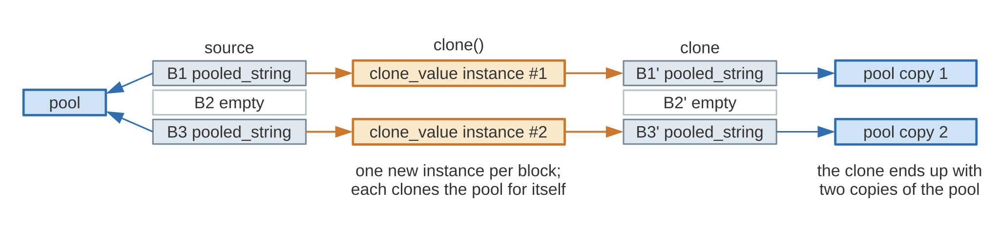
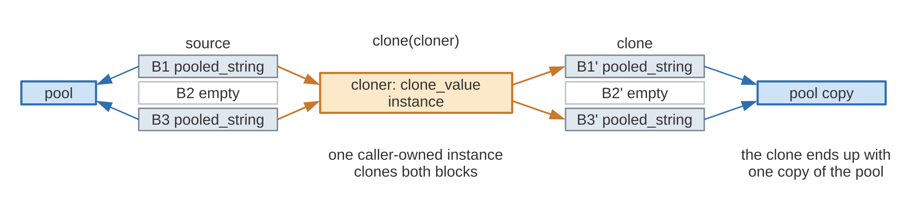
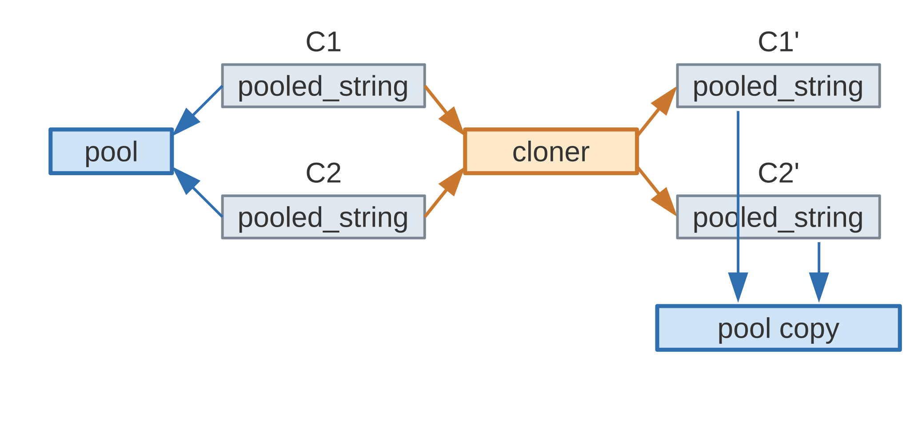

.. SPDX-FileCopyrightText: 2026 Kohei Yoshida
..
.. SPDX-License-Identifier: MIT

.. _mtv-example-cloning-stateful:

Stateful Cloning
================

The :ref:`previous section <mtv-example-cloning>` showed how a
``clone_value`` specialization makes a non-copyable block cloneable by
cloning one element at a time.  This section builds on that and
illustrates how the cloner itself can carry state across the elements of
a block.

When :cpp:func:`~mdds::mtv::soa::multi_type_vector::clone()` clones a
block, it creates exactly one instance of the ``clone_value``
specialization for that block, and applies it to the elements strictly in
the order they are stored in the block.  The block is therefore the
default scope of the cloner's state; the section
:ref:`mtv-example-cloning-stateful-shared` below shows how to widen that
scope by passing your own instance.  If an exception is thrown mid-way
through a block, the partially built copy of the block gets destroyed,
which in turn destroys the values cloned up to that point; any preceding
blocks that have already been cloned get destroyed as well, leaving no
leaked values.  Thanks to the
first two guarantees, the ``operator()`` of a specialization may be
non-const, which allows the cloner to carry state across the elements of a
block while cloning.

.. warning::

   These guarantees, including the exception and memory leak safety, only
   apply when the ``clone_value`` specialization does not declare an
   ``exec_policy`` type.  Refer to the :ref:`mtv-example-exec-policy`
   section for how a specialization with an ``exec_policy`` behaves.

To see how a stateful cloner can be useful, consider a scenario where each
element references a string stored in a pool shared by all elements in the
same block.  When cloning such elements, the pool itself should be cloned
only once per block, with all the cloned elements referencing the new
pool.  This requires the cloner to remember the cloned pool between its
invocations, which is exactly what a stateful cloner enables.

First, let's define the shared pool and the value type that references it:

.. literalinclude:: ../../../../example/multi_type_vector/clone_stateful.cpp
   :language: C++
   :start-after: //!code-start: pooled-string
   :end-before: //!code-end: pooled-string

Since ``pooled_string`` is non-copyable, we'll store its instances as
pointers in a block of type
:cpp:class:`~mdds::mtv::noncopyable_managed_element_block`:

.. literalinclude:: ../../../../example/multi_type_vector/clone_stateful.cpp
   :language: C++
   :start-after: //!code-start: elem-block-def
   :end-before: //!code-end: elem-block-def

Once the element block type is defined, plug it into the traits type and
define the actual ``multi_type_vector`` type:

.. literalinclude:: ../../../../example/multi_type_vector/clone_stateful.cpp
   :language: C++
   :start-after: //!code-start: mtv-def
   :end-before: //!code-end: mtv-def

Next, we'll define the ``clone_value`` specialization, this time with a
non-const ``operator()`` and a member variable that holds the cloned pool:

.. literalinclude:: ../../../../example/multi_type_vector/clone_stateful.cpp
   :language: C++
   :start-after: //!code-start: clone-value-ts
   :end-before: //!code-end: clone-value-ts

The first invocation clones the pool and stores it in the ``cloned_pool``
member, and all subsequent invocations simply re-use it.  Since ``clone()``
creates one cloner instance per block, the pool gets cloned exactly once
per block.

Since we have all necessary pieces defined, let's instantiate our
``multi_type_vector`` instance and populate it with elements that all
share one pool:

.. literalinclude:: ../../../../example/multi_type_vector/clone_stateful.cpp
   :language: C++
   :start-after: //!code-start: populate-store
   :end-before: //!code-end: populate-store
   :dedent: 4

Let's clone this instance by calling the
:cpp:func:`~mdds::mtv::soa::multi_type_vector::clone()` method:

.. literalinclude:: ../../../../example/multi_type_vector/clone_stateful.cpp
   :language: C++
   :start-after: //!code-start: clone-store
   :end-before: //!code-end: clone-store
   :dedent: 4

Finally, let's inspect both containers to confirm that each element was
cloned and that the original and the clone reference separate pools:

.. literalinclude:: ../../../../example/multi_type_vector/clone_stateful.cpp
   :language: C++
   :start-after: //!code-start: inspect-store
   :end-before: //!code-end: inspect-store
   :dedent: 4

You will see output similar to the following when executing this code:

.. code-block:: none

   cloning the container...
   cloning a pool of 4 strings
   done cloning
   element 0: "alpha" (pool is separate)
   element 1: "gamma" (pool is separate)
   element 2: "beta" (pool is separate)
   element 3: "delta" (pool is separate)

The output indicates that the shared pool was cloned only once for the
whole block, and that the cloned container references its own pool fully
independent of the original.

         elements reference one pool.  clone() creates one clone_value
         instance for B1 and another for B3, and the clone ends up with
         two copies of the pool.

   With ``clone()``, each block is cloned by its own ``clone_value``
   instance, so a pool shared by two blocks is cloned twice.

.. _mtv-example-cloning-stateful-shared:

Sharing state across blocks and containers
------------------------------------------

The pool in the example above is shared by the elements of one block.  A
pool may just as well be shared by elements stored in different blocks of
one container, or in different containers.  Since ``clone()`` creates a
new cloner instance for each block, each instance clones the pool for
itself, and the clone ends up with one copy of the pool per block.  To
see this, let's populate a container with elements that reference one
pool from two blocks, separated by an empty block:

.. literalinclude:: ../../../../example/multi_type_vector/clone_stateful.cpp
   :language: C++
   :start-after: //!code-start: populate-split
   :end-before: //!code-end: populate-split
   :dedent: 4

Cloning it with ``clone()`` and comparing the pools referenced from the
two blocks of the clone:

.. literalinclude:: ../../../../example/multi_type_vector/clone_stateful.cpp
   :language: C++
   :start-after: //!code-start: clone-split
   :end-before: //!code-end: clone-split
   :dedent: 4

produces the following output:

.. code-block:: none

   cloning the container with two blocks...
   cloning a pool of 4 strings
   cloning a pool of 4 strings
   done cloning
   pool is separate between the two blocks

The pool got cloned twice, once by each cloner instance, and the two
blocks of the clone no longer share a pool.

To keep the pool shared, the cloner must carry its state across the
blocks, which requires one instance to clone both.  The
:cpp:func:`~mdds::mtv::soa::multi_type_vector::clone()` overload that
takes ``clone_value`` instances lets you do that: you create the instance
yourself and pass it to the call, and every block whose ``clone_value``
type is the type of the passed instance gets cloned through it.  Blocks
of other types are cloned as before, with a new instance per block.

.. literalinclude:: ../../../../example/multi_type_vector/clone_stateful.cpp
   :language: C++
   :start-after: //!code-start: clone-split-passed
   :end-before: //!code-end: clone-split-passed
   :dedent: 4

This time the pool gets cloned only once:

.. code-block:: none

   cloning the container with two blocks through one cloner...
   cloning a pool of 4 strings
   done cloning
   pool is shared between the two blocks

         and B3 are cloned through the one caller-owned clone_value
         instance, and the clone ends up with one copy of the pool.

   With ``clone(cloner)``, the caller-owned instance clones both blocks,
   so the pool is cloned once.

The passed instance is yours, so you decide its scope.  Passing the same
instance to the ``clone()`` calls of several containers extends the scope
to all of them.  Let's create a second container whose elements reference
the same pool, and clone both containers through one instance:

.. literalinclude:: ../../../../example/multi_type_vector/clone_stateful.cpp
   :language: C++
   :start-after: //!code-start: clone-two-containers
   :end-before: //!code-end: clone-two-containers
   :dedent: 4

The pool gets cloned once for the three blocks of the two containers, and
the two clones share it:

.. code-block:: none

   cloning two containers through one cloner...
   cloning a pool of 4 strings
   done cloning
   pool is shared between the two clones

         cloned through the same clone_value instance.  The clones C1' and
         C2' reference one copy of the pool.

   Cloning two containers that share a pool through one instance: the
   pool is cloned once, and both clones reference the copy.

A few rules apply to a passed instance.  It must be an instance of a
``clone_value`` specialization that declares no ``exec_policy``; a
specialization with an ``exec_policy`` is stateless by contract and may
get copied while cloning, so there is no state to share and passing one
is rejected at compile time.  You may pass several instances of different
``clone_value`` types to one call, but at most one per type.  When at
least one instance is passed, the blocks are cloned sequentially in their
stored order regardless of the ``exec_policy`` of the traits, since the
instance must not be invoked from several threads.  And if cloning throws
mid-way, the instance is left in whatever state it has reached, so do not
reuse it afterwards.

Two cloners of different types can share state as well.  Since you own
the instances, you can give each of them a pointer or a reference to one
object you also own, and pass both instances to the same calls.

With copy-on-write enabled, ``clone()`` only borrows the blocks of the
source and clones nothing, so the passed instances are left untouched.
The deferred clone happens when the clone detaches, and the
:cpp:func:`~mdds::mtv::soa::multi_type_vector::detach()` overload that
takes ``clone_value`` instances lets you pass them at that point; see
:ref:`mtv-copy-on-write-detach-cloners`.

When even a stateful cloner does not fit your scenario and you need full
control over how an entire block gets reconstructed, you can take over
the cloning of the whole block as described in
:ref:`mtv-example-cloning-block`.
